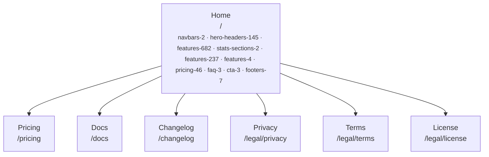

# Smoketest — proposal

## Summary

7 planned page(s); the homepage is built from 10 layout-library section(s). The theme changes 67 token value(s) and the body font to DM Sans; token names and layout tokens are unchanged.

## Theme

| Token | Breakpoint | From | To |
|---|---|---|---|
| `--color-black-alpha-0` | all | `rgba(13, 13, 13, 0)` | `rgba(27, 20, 38, 0)` |
| `--color-black-alpha-1` | all | `rgba(13, 13, 13, 0.01)` | `rgba(27, 20, 38, 0.01)` |
| `--color-black-alpha-10` | all | `rgba(13, 13, 13, 0.1)` | `rgba(27, 20, 38, 0.1)` |
| `--color-black-alpha-20` | all | `rgba(13, 13, 13, 0.2)` | `rgba(27, 20, 38, 0.2)` |
| `--color-black-alpha-30` | all | `rgba(13, 13, 13, 0.3)` | `rgba(27, 20, 38, 0.3)` |
| `--color-black-alpha-40` | all | `rgba(13, 13, 13, 0.4)` | `rgba(27, 20, 38, 0.4)` |
| `--color-black-alpha-50` | all | `rgba(13, 13, 13, 0.5)` | `rgba(27, 20, 38, 0.5)` |
| `--color-black-alpha-60` | all | `rgba(13, 13, 13, 0.6)` | `rgba(27, 20, 38, 0.6)` |
| `--color-black-alpha-70` | all | `rgba(13, 13, 13, 0.7)` | `rgba(27, 20, 38, 0.7)` |
| `--color-black-alpha-80` | all | `rgba(13, 13, 13, 0.8)` | `rgba(27, 20, 38, 0.8)` |
| `--color-black-alpha-90` | all | `rgba(13, 13, 13, 0.9)` | `rgba(27, 20, 38, 0.9)` |
| `--color-black-alpha-100` | all | `#0D0D0D` | `#1B1426` |
| `--color-yellow-alpha-0` | all | `rgba(238, 237, 46, 0)` | `rgba(91, 63, 224, 0)` |
| `--color-yellow-alpha-1` | all | `rgba(238, 237, 46, 0.01)` | `rgba(91, 63, 224, 0.01)` |
| `--color-yellow-alpha-4` | all | `rgba(238, 237, 46, 0.04)` | `rgba(91, 63, 224, 0.04)` |
| `--color-yellow-alpha-10` | all | `rgba(238, 237, 46, 0.1)` | `rgba(91, 63, 224, 0.1)` |
| `--color-yellow-alpha-16` | all | `rgba(238, 237, 46, 0.16)` | `rgba(91, 63, 224, 0.16)` |
| `--color-yellow-alpha-20` | all | `rgba(238, 237, 46, 0.2)` | `rgba(91, 63, 224, 0.2)` |
| `--color-yellow-alpha-30` | all | `rgba(238, 237, 46, 0.3)` | `rgba(91, 63, 224, 0.3)` |
| `--color-yellow-alpha-40` | all | `rgba(238, 237, 46, 0.4)` | `rgba(91, 63, 224, 0.4)` |
| `--color-yellow-alpha-50` | all | `rgba(238, 237, 46, 0.5)` | `rgba(91, 63, 224, 0.5)` |
| `--color-yellow-alpha-60` | all | `rgba(238, 237, 46, 0.6)` | `rgba(91, 63, 224, 0.6)` |
| `--color-yellow-alpha-70` | all | `rgba(238, 237, 46, 0.7)` | `rgba(91, 63, 224, 0.7)` |
| `--color-yellow-alpha-80` | all | `rgba(238, 237, 46, 0.8)` | `rgba(91, 63, 224, 0.8)` |
| `--color-yellow-alpha-90` | all | `rgba(238, 237, 46, 0.9)` | `rgba(91, 63, 224, 0.9)` |
| `--color-yellow-alpha-100` | all | `#EEED2E` | `#5B3FE0` |
| `--bg-main` | all | `var(--color-black-alpha-100)` | `var(--color-white-alpha-100)` |
| `--bg-main-transparent` | all | `var(--color-black-alpha-90)` | `var(--color-white-alpha-90)` |
| `--bg-secondary` | all | `var(--color-white-alpha-6)` | `#F9F7FC` |
| `--bg-tertiary` | all | `var(--color-white-alpha-10)` | `#EFEBFF` |
| `--bg-additional` | all | `var(--color-white-alpha-20)` | `#E4DDFB` |
| `--bg-reverse` | all | `var(--color-white-alpha-100)` | `var(--color-black-alpha-100)` |
| `--bg-decorative` | all | `var(--color-deep-black-alpha-100)` | `#1B1426` |
| `--text-main` | all | `var(--color-white-alpha-100)` | `var(--color-black-alpha-100)` |
| `--text-secondary` | all | `var(--color-white-alpha-70)` | `#687083` |
| `--text-tertiary` | all | `var(--color-white-alpha-50)` | `var(--color-black-alpha-60)` |
| `--text-additional` | all | `var(--color-white-alpha-40)` | `var(--color-black-alpha-50)` |
| `--text-reverse` | all | `var(--color-black-alpha-100)` | `var(--color-white-alpha-100)` |
| `--text-reverse-secondary` | all | `var(--color-black-alpha-50)` | `var(--color-white-alpha-70)` |
| `--icon-main` | all | `var(--color-white-alpha-100)` | `var(--color-black-alpha-100)` |
| `--icon-secondary` | all | `var(--color-white-alpha-70)` | `#687083` |
| `--icon-tertiary` | all | `var(--color-white-alpha-50)` | `var(--color-black-alpha-60)` |
| `--icon-additional` | all | `var(--color-white-alpha-40)` | `var(--color-black-alpha-50)` |
| `--icon-reverse` | all | `var(--color-black-alpha-100)` | `var(--color-white-alpha-100)` |
| `--icon-reverse-secondary` | all | `var(--color-black-alpha-50)` | `var(--color-white-alpha-70)` |
| `--line-main` | all | `var(--color-white-alpha-100)` | `var(--color-black-alpha-100)` |
| `--line-secondary` | all | `var(--color-white-alpha-32)` | `var(--color-black-alpha-20)` |
| `--line-tertiary` | all | `var(--color-white-alpha-16)` | `var(--color-black-alpha-10)` |
| `--line-additional` | all | `var(--color-white-alpha-8)` | `rgba(27, 20, 38, 0.06)` |
| `--radius-2` | all | `2px` | `6px` |
| `--radius-4` | all | `4px` | `10px` |
| `--radius-12` | all | `12px` | `16px` |
| `--radius-16` | all | `16px` | `24px` |
| `--font-titles-h1-size` | mobile | `36px` | `42px` |
| `--font-titles-h1-line-height` | mobile | `44px` | `46px` |
| `--font-titles-h3-line-height` | mobile | `32px` | `28px` |
| `--font-titles-h1-size` | tablet | `36px` | `56px` |
| `--font-titles-h1-line-height` | tablet | `44px` | `60px` |
| `--font-titles-h2-size` | tablet | `32px` | `40px` |
| `--font-titles-h2-line-height` | tablet | `38px` | `46px` |
| `--font-titles-h3-size` | tablet | `22px` | `24px` |
| `--font-titles-h3-line-height` | tablet | `32px` | `30px` |
| `--font-titles-h1-size` | desktop | `42px` | `72px` |
| `--font-titles-h1-line-height` | desktop | `50px` | `76px` |
| `--font-titles-h2-size` | desktop | `36px` | `48px` |
| `--font-titles-h2-line-height` | desktop | `44px` | `54px` |
| `--font-titles-h3-line-height` | desktop | `40px` | `34px` |

Fonts: body → **DM Sans**, sans-serif fallback (public/fonts/latin-400-normal.woff2, public/fonts/latin-500-normal.woff2, public/fonts/latin-600-normal.woff2, public/fonts/latin-700-normal.woff2).

## Sitemap

| Page | Path | Purpose |
|---|---|---|
| Home | `/` | Explain Smoketest and turn founders into Pro buyers, with Lite as the free start |
| Pricing | `/pricing` | Compare Lite, Pro and Agency in full, with license and refund notes |
| Docs | `/docs` | Setup, config schema, lead providers, agent skills and validate checks |
| Changelog | `/changelog` | Release notes, with an RSS feed |
| Privacy | `/legal/privacy` | Privacy policy for this site |
| Terms | `/legal/terms` | Terms of sale and use |
| License | `/legal/license` | The Lite (MIT) and Pro/Agency license texts |

## Homepage

| # | Section | Group | Why |
|---|---|---|---|
| 1 | `navbars-2` | Navbar with simple dropdown | Brand, the four pages and both calls to action; the one header that takes real links |
| 2 | `hero-headers-145` | Stacked hero with buttons | The positioning line over a full-bleed product shot, like Qarin's hero |
| 3 | `features-682` | Image with three feature points | How it works: three numbered steps beside one composite of the interview, the live page and the report |
| 4 | `stats-sections-2` | Stats below header with buttons | Real product facts in place of a logo strip: the honesty rules forbid invented proof |
| 5 | `features-237` | Header and three-column feature grid | The four parts that make it a measurement engine, on a tinted band for rhythm |
| 6 | `features-4` | Feature text with image and video | The fake door is the core difference, so it gets its own split section with a visual |
| 7 | `pricing-46` | Three-plan pricing row | The three editions side by side, Pro highlighted |
| 8 | `faq-3` | FAQ with heading beside accordion | Straight answers, including what the template won't do |
| 9 | `cta-3` | Centered CTA with buttons | A centred closing call to action that repeats both offers |
| 10 | `footers-7` | Minimal footer with links | A minimal product footer with the pages and the legal links |

## Images

| # | Section | Element | File |
|---|---|---|---|
| 2 | `hero-headers-145` | `hero-header-82__image` | `content/hero-product.svg` |
| 3 | `features-682` | `feature-459__media` | `content/how-it-works.svg` |
| 6 | `features-4` | `feature-4__media` | `content/fake-door.svg` |

## Not covered by the library

- Qarin's centred hero with a version pill: the library's image-below heroes are left-aligned, so hero-headers-145 is used
- Qarin's dark feature band and blue stats, pricing and CTA bands: no section offers a dark or accent surface, only plain, tinted or image-under-a-white-overlay
- Rounded buttons, inputs and tags: Button, TextInput and Tag have no border-radius, so their corners stay square whatever the theme says
- Section buttons link to #: only the navbar takes hrefs, so Get Pro, Start free and the plan buttons can't point at {{BUY_URL}} or the GitHub repo yet
- The Smoketest wordmark: CompanyLogo draws the kit's placeholder mark, and logoLabel is only its accessible name
- Per-feature icons: the feature grid uses one fixed icon for all four items
- Qarin's 'Most popular' badge on the middle plan: the highlighted Pro card gets a blue border only
- A visible 'How it works' title: features-682 renders its heading for screen readers only
- One image per step card: repeated cards share one image class, so the three steps share one composite image

## Suggested component improvements

- **hero-headers/g15** — primaryHref and secondaryHref props; every section's buttons are hard-coded to href="#"
- **features/g43** — A 'reverse' surface (bg-reverse with text-reverse) for dark bands, and an icon prop per feature
- **cta/g3** — The tertiary and image surfaces switch to alternate buttons, which assume a dark surface; on a light theme the secondary label turns white on a light fill
- **navbars/g2** — A text wordmark option for the logo, so logoLabel can be shown
- **hero-headers/g9** — The group is labelled 'centered' but its members are split or left-aligned; relabel it, or add a centred hero with a tagline pill and an image below
- **pricing/g6** — A badge label for the highlighted plan, and a per-plan href for its button
- **hero-headers/g15** — hero-headers-26/-71 (HeroHeader24) set their image class with class:list, so the builder finds no image slot; use a static class attribute
- **features/g41** — A visible heading option for features-682 (it is sr-only today)
- **features/g43** — Per-item image classes (e.g. an index modifier) so each card of features-239 can carry its own image
